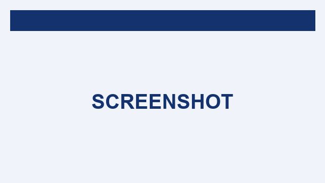

# Release notes 9.0.0

Welcome to the 9.0.0 release.

## Highlights

| Feature | Status |
|---------|--------|
| Chromium routes | stable |
| PDF remediation | new |

## Code sample

```go
func main() {
    fmt.Println("CODE-BLOCK-MARKER")
}
```

## Checklist

~~Removed legacy flag~~

- [x] Done item DONE-TASK
- [ ] Open item OPEN-TASK

## Glossary

Gotenberg
:   A document-to-PDF API.

LibreOffice
:   Office suite used for conversions.

## Links

Visit https://gotenberg.dev for docs.



<script>document.title='pwned'</script>SANITIZE-ME-MARKER
